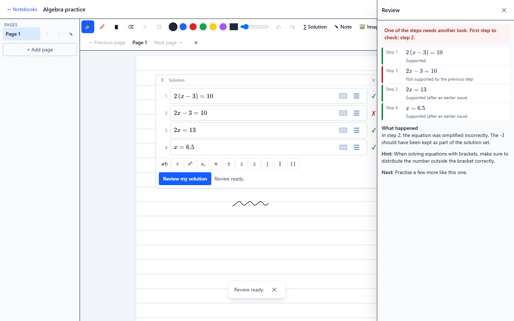
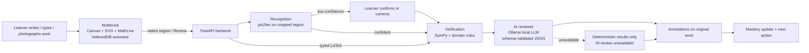

# MathMind — Intelligent Mathematics Notebook

> A digital notebook that understands mathematical **work**, not just final answers.

**Touch-first, not touch-only** · **General-purpose learning** · **Offline-first** · **Open-source stack** · **No paid APIs**

MathMind is an open-source, AI-assisted mathematics learning workspace built around a natural digital notebook. Learners write with a stylus or finger on tablets, type structured equations with a keyboard on laptops, or import photos of paper work. MathMind recognizes the mathematical regions, **verifies each transformation symbolically**, explains the likely mistake next to the learner's own work, and adapts the next activity based on what the learner has shown they understand.

> **Status (2026-11-28):** working MVP. The notebook, typed and image review, SymPy verification, the local AI
> reviewer, mastery and the progress page run end to end on a laptop with `docker compose`. Numbers below are
> **measured** ([what was measured, and how](#measured-results)); anything not yet tested says so.



---

## Table of contents

- [Why MathMind](#why-mathmind)
- [Core features (MVP)](#core-features-mvp)
- [How it works](#how-it-works)
- [Tech stack](#tech-stack)
- [Repository layout](#repository-layout)
- [Measured results](#measured-results)
- [Getting started](#getting-started)
- [Documentation map](#documentation-map)
- [Team and workflow](#team-and-workflow)
- [Design principles](#design-principles)
- [Privacy and zero-cost policy](#privacy-and-zero-cost-policy)
- [Known limitations](#known-limitations)
- [License](#license)

---

## Why MathMind

Two students can write the same wrong answer for different reasons: a missing prerequisite, an invalid algebraic step, the wrong formula, or an arithmetic slip. Most tools only check the final answer, so they treat all of these the same way.

MathMind analyses the learner's **working**. It:

1. captures the written process (ink strokes, typed equation blocks, or photos),
2. builds an ordered list of solution steps,
3. checks each transformation with **SymPy** (deterministic, not LLM-guessing),
4. uses a **local** language model only to *explain* verified findings and suggest a hint,
5. updates a concept-level mastery estimate and picks a sensible next activity.

## Core features (MVP)

| Priority | Feature | What "done" means | Built |
|---|---|---|---|
| P0 | Notebook pages & tools | Create notebooks, write, erase, undo/redo, navigate pages, autosave | ✅ |
| P0 | Cross-device input | Tablet: stylus/touch ink · Phone: short practice + camera import · Non-touch laptop: full workflow via keyboard equation blocks (MathLive) | ✅ automated tests in Chromium device emulation; manual device matrix pending |
| P0 | Expandable workspace | Extra working space without losing page context | ✅ |
| P0 | Typed input | Enter a supported expression and send it for verification | ✅ |
| P0 | Handwritten image workflow | Import/capture a region → candidate recognition → learner confirms/corrects | ✅ UI + API; pix2tex is an optional install, not yet measured on real handwriting |
| P0 | SymPy verification | Each supported step returns `supported`, `incorrect` or `inconclusive` | ✅ |
| P0 | On-demand review | "Review my solution" returns structured feedback anchored to the page region | ✅ |
| P0 | Graceful failure | Unreadable input or model offline → work preserved, clear status shown | ✅ ([R3-2](docs/evidence/R3-2/notes.md)) |
| P0 | Basic mastery profile | A small concept set tracks attempts and updates a mastery estimate | ✅ |
| P1 | Live assistance | Light, optional, debounced hints — never on every stroke | ❌ not built |
| P1 | Adaptive question selection | Pick prerequisite / practice / next question from evidence | ✅ "Next up" + practise this problem |
| P2 | Gamification, analytics, teacher summaries | Only after core reliability | progress page only |

Also built: export / delete all my data (JSON) from the progress page.

## How it works



The **notebook and deterministic verification work without any LLM**. The LLM only explains evidence that SymPy has already produced.

## Tech stack

| Layer | Technology |
|---|---|
| Frontend | React + TypeScript + Vite, Tailwind CSS, Zustand |
| Ink & overlays | HTML Canvas (strokes) + SVG (selection/annotations) + DOM (UI), Pointer Events API |
| Equation input / render | MathLive (keyboard-first blocks) · KaTeX (rendering) |
| Local storage | IndexedDB (via Dexie) in browser · SQLite on the backend |
| Backend | Python 3.11 + FastAPI + Pydantic v2 + SQLModel |
| Recognition | pix2tex (LaTeX-OCR) on cropped regions |
| Verification | SymPy (+ `antlr4-python3-runtime` for LaTeX parsing) |
| Local reasoning | Ollama + an open-weight model chosen by benchmark (e.g. Qwen2.5 family) |
| Charts / graphs | Recharts (progress) · JSXGraph/SVG (later) |
| Testing | Vitest, React Testing Library, Playwright, pytest, Hypothesis, axe-core |
| Optional | PostgreSQL for self-hosted sync, Docker Compose |

Full rationale: [docs/02-architecture.md](docs/02-architecture.md).

## Repository layout

```text
MathMind/
├── frontend/                  # React + TS + Vite app
│   └── src/
│       ├── components/        # shared UI
│       ├── notebook/          # canvas, tools, pages, strokes, annotations
│       ├── features/          # ai-review, learning, mastery, analytics
│       └── services/          # api client, db (Dexie), device detection
├── backend/
│   └── app/
│       ├── api/               # FastAPI routers (v1)
│       ├── core/              # config, logging, errors
│       ├── models/            # SQLModel tables
│       ├── schemas/           # Pydantic request/response models
│       ├── repositories/      # DB access
│       └── services/          # recognition, verification, reasoning, adaptation
├── ai/                        # prompts, evaluation harness, benchmarks
├── datasets/                  # concepts, problems, labelled_solutions, handwriting_samples
├── shared/contracts/          # OpenAPI + JSON Schemas + examples (source of truth for API shapes)
├── scripts/                   # dev / seed / smoke scripts
├── docs/                      # all planning + architecture docs (start here)
├── docker-compose.yml
├── .env.example
├── AGENTS.md                  # rules for AI coding agents working in this repo
└── README.md
```


## Measured results

Measured 2026-11-28 on one laptop (Intel Core Ultra 5 125U, 15.4 GB RAM, Windows 11, CPU only). Full reports linked.

| What | Result | Source |
|---|---|---|
| SymPy first-error localization (120 labelled solutions, 68 with an error) | **100 %** | [SymPy-only report](ai/evaluation/reports/2026-11-28-sympy-only.md) |
| Correct work wrongly marked `incorrect` | **none** | same |
| Correct solutions fully confirmed / inconclusive items | 93.3 % / 2.5 % | same |
| LLM output valid against the schema (after one retry) | 100 % (40 items, qwen2.5:3b) | [LLM report](ai/evaluation/reports/2026-11-28-qwen2.5-3b.md) |
| LLM error-type accuracy | 52 % with `reviewer_v1`: the weak spot, see [limitations](#known-limitations) | same |
| Verify stage latency | p50 ≈ 0.1 s | [performance.md](ai/benchmarks/performance.md) |
| AI explanation latency (qwen2.5:3b, CPU) | p50 40 s, p95 97 s; first call after start 1–2 min | same |
| Cost per evaluation | ₹0 / $0 incremental (everything local) | same |
| R2/R3 functionality cases | 5 pass; R3-1 shown with mock OCR only | [docs/evidence](docs/evidence/README.md) |

**Tested on:** Chromium (Playwright) at laptop 1440×900 and in iPad Pro 11 / iPhone 13 emulation, plus axe
accessibility checks. Real tablets, phones and other browsers have **not** been tested yet (T7.4).

## Getting started

### Prerequisites

| Tool | Version | Why |
|---|---|---|
| Git | any recent | source control |
| Node.js | 20 LTS | frontend |
| pnpm *or* npm | pnpm 9 / npm 10 | package manager (team picks one in T0.1) |
| Python | 3.11 | backend, SymPy, pix2tex |
| Ollama | latest stable | local LLM runtime (optional at runtime) |
| ~10 GB disk, 16 GB RAM recommended | — | model weights + pix2tex/torch |
| Docker Desktop (optional) | any recent | one-command run |

Full list including devices, accounts and licences: [docs/06-external-requirements.md](docs/06-external-requirements.md).

### One command (Docker)

```bash
cp .env.example .env
docker compose up -d --build                 # app on http://localhost:8080 (SymPy checks, no AI text)
docker compose --profile ai up -d --build    # + Ollama; then pull the model once:
docker compose exec ollama ollama pull qwen2.5:3b
```

Ports come from `.env` (`WEB_HOST_PORT`, `BACKEND_HOST_PORT`) and are bound to 127.0.0.1. The first AI review after a
start loads the model (1–2 min on CPU). For handwriting OCR build the backend with `--build-arg WITH_ML=true`
(adds pix2tex and CPU torch, several GB). `scripts/dev.sh` / `scripts/dev.ps1` start the setup below.

### Run locally (without Docker)

```bash
# 1. Clone
git clone <repo-url> MathMind && cd MathMind
cp .env.example .env

# 2. Backend
cd backend
python -m venv .venv
# Windows: .venv\Scripts\activate   |  macOS/Linux: source .venv/bin/activate
pip install -r requirements.txt -r requirements-dev.txt
uvicorn app.main:app --reload --port 8000

# 3. Frontend (new terminal)
cd frontend
npm install
npm run dev            # http://localhost:5173

# 4. Optional: local LLM
ollama pull qwen2.5:3b # or the model chosen in T5.1
ollama serve
```

### Run tests

```bash
cd backend  && pytest -q                 # unit + integration
cd frontend && npm run test              # Vitest unit/component
cd frontend && npx playwright test       # end-to-end with a mocked API (starts its own dev server)
cd frontend && npm run e2e:real          # end-to-end against a real backend (AI off)
python ai/evaluation/run_eval.py --dataset datasets/labelled_solutions   # evaluation metrics
```

## Documentation map

| Doc | Read it if you want to… |
|---|---|
| [docs/README.md](docs/README.md) | See every doc and the reading order |
| [docs/01-product-overview.md](docs/01-product-overview.md) | Understand the product, users and scope |
| [docs/02-architecture.md](docs/02-architecture.md) | Understand modules, data model, API, pipelines |
| [docs/03-team-roles.md](docs/03-team-roles.md) | See who owns what (4-person team) |
| [docs/plan/README.md](docs/plan/README.md) | See the full phased plan with every task, step and sub-step |
| [docs/04-dependencies-and-parallelism.md](docs/04-dependencies-and-parallelism.md) | Know what can run in parallel, prerequisites, critical path |
| [docs/05-testing-strategy.md](docs/05-testing-strategy.md) | Know which tests to write, when, and by whom |
| [docs/06-external-requirements.md](docs/06-external-requirements.md) | Install tools, models, devices, accounts |
| [docs/07-conventions.md](docs/07-conventions.md) | Branching, commits, PRs, code style |
| [docs/08-risks-and-limitations.md](docs/08-risks-and-limitations.md) | Risks and mitigations |
| [docs/09-ai-disclosure-log.md](docs/09-ai-disclosure-log.md) | Log AI-assisted contributions (hackathon A4) |
| [docs/10-evaluation-plan.md](docs/10-evaluation-plan.md) | Metrics, dataset, R2/R3 evidence |
| [docs/11-demo-script.md](docs/11-demo-script.md) | Demo run sheet and fallbacks (draft) |
| [docs/task-board.md](docs/task-board.md) | Live status of every task |
| [docs/team/](docs/team/) | **Personal guide per team member — feed yours to your AI agent** |
| [AGENTS.md](AGENTS.md) | Rules every AI coding agent must follow here |

Original specification: `MathMind_Product_Specification_and_Technical_Architecture (2).docx`.

## Team and workflow

The project is planned for **4 people over 7 days (+ a half-day setup)**:

| ID | Role | Focus |
|---|---|---|
| **M1** | Tech Lead & Backend/Integration | repo, API contract, FastAPI, orchestration, CI, demo |
| **M2** | Frontend / Notebook Engineer | canvas ink, tools, IndexedDB, MathLive, annotations, responsive UI |
| **M3** | Math & AI Engineer | SymPy verification, pix2tex, Ollama reviewer, mastery & adaptive engine, eval harness |
| **M4** | Junior — QA, Content & Docs *(lighter load, step-by-step tasks)* | concept/problem data, labelled dataset, manual device testing, progress page, docs |

Each member has a personal guide in [docs/team/](docs/team/) written so it can be pasted straight into an AI coding agent as context.

## Design principles

1. **Notebook first** — writing and solving is the main activity, not chatting.
2. **Preserve original work** — strokes and images are never replaced by OCR output.
3. **Verify before explaining** — SymPy constrains what the LLM may say.
4. **Ask when uncertain** — low-confidence OCR must be confirmed before judging maths.
5. **Adapt from evidence** — mastery changes only from real attempts.
6. **Graceful degradation** — everything except AI explanations works without the LLM.
7. **Privacy by default** — data stays local unless the learner opts in to sync.

## Privacy and zero-cost policy

- No OpenAI / Gemini / Anthropic / paid inference APIs at runtime. No commercial OCR.
- Notebook editing, autosave and SymPy checks work **offline**.
- If the device cannot run a model, AI review is labelled **unavailable**. It never falls back silently to a paid service.
- Uploads are validated (type, size, dimensions), model output is schema-validated and **never executed**.
- "Free" means no mandatory subscriptions. Hardware, electricity and optional hosting are still real costs.

## Known limitations

- pix2tex is a single-expression recognizer. Full multi-column pages with prose and diagrams are out of MVP scope, so users select regions instead.
- Generic symbolic equivalence cannot validate every transformation. Unsupported cases return `inconclusive`.
- Local models can produce plausible but wrong explanations. Our own evidence shows it: on
  [R2-D](docs/evidence/R2-D/notes.md) the 3B model called a wrong factorisation correct while SymPy marked it
  incorrect. Verdicts always come from SymPy; `reviewer_v2` passes SymPy-expanded steps to the model to reduce this.
- AI explanations take 20–120 s on a CPU-only laptop; a classroom would need a GPU or a smaller model.
- Handwriting recognition (pix2tex) has not been measured on real handwriting yet.
- Mastery is an **estimate** (`M_new = 0.7·M_old + 0.3·S`), not a validated learning-science model.

See [docs/08-risks-and-limitations.md](docs/08-risks-and-limitations.md).

## License

To be decided by the team (recommended: MIT or Apache-2.0). Check the licences of bundled models, pix2tex weights and any dataset before redistribution (see [docs/06-external-requirements.md#7-licences](docs/06-external-requirements.md#licences)).
