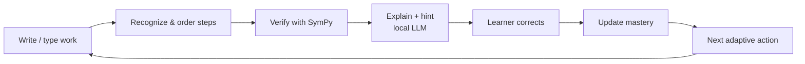

# 01 — Product Overview

Condensed from the MathMind Product Specification & Technical Architecture.

## 1. Vision

> A notebook that does not merely store what a learner writes, but helps interpret what they are trying to solve, where their reasoning may have gone wrong and what would help them improve.

MathMind is an AI-assisted mathematics workspace built around a natural digital notebook. Assistance appears **beside the learner's work**: they select an equation, review a step, or request feedback on a whole page without leaving the notebook. There is no separate chat screen.

### The learning loop

## 2. Problem

Digital tools usually grade the **final answer**. A wrong answer can come from a missing prerequisite, an invalid transformation, the wrong formula, or an arithmetic slip, and each of these needs a different intervention. MathMind treats the **working** as the thing to analyse.

## 3. Users

| User group | Need | Product response |
|---|---|---|
| Independent learners | Flexible practice & understanding | Notebook-first, contextual hints, personalised revision |
| Curriculum students | Support across topics, no fixed grade | General topic map + prerequisite progression |
| Self-directed / advanced | Move across levels | Open topic selection, concept-level mastery |
| Teachers / mentors *(later)* | See recurring difficulties | Optional summaries — **not MVP** |

## 4. Product principles

1. Notebook first
2. Preserve original work
3. Verify before explaining
4. Ask when uncertain
5. Adapt from evidence
6. Graceful degradation
7. Privacy by default

## 5. Syllabus model

No grade selector. Topics live in a **concept graph** with prerequisite edges across these domains: Arithmetic & number sense, Algebra, Geometry, Trigonometry, Calculus, Linear algebra, Probability & statistics, Discrete maths, Advanced maths.

**MVP content strategy:** start with a small, well-tested set. Recommended MVP concepts:

| Concept id | Domain | Prerequisites |
|---|---|---|
| `integer_arithmetic` | Arithmetic | — |
| `fractions` | Arithmetic | `integer_arithmetic` |
| `algebraic_expressions` | Algebra | `integer_arithmetic` |
| `linear_equations` | Algebra | `algebraic_expressions`, `fractions` |
| `factorization` | Algebra | `algebraic_expressions` |
| `quadratic_equations` | Algebra | `factorization`, `linear_equations` |
| `exponents` | Arithmetic | `integer_arithmetic` |

## 6. Device strategy — touch-first, not touch-only

| Device | Primary experience | Requirement |
|---|---|---|
| Tablet / stylus | Full notebook: ink, diagrams, live assist, review | Primary demo target |
| Phone | Short practice, review, browsing, **camera capture** | No long multi-step writing |
| Touch laptop / 2-in-1 | Switch ink ↔ keyboard equation entry | Keep page context when switching |
| Non-touch laptop / desktop | **Keyboard-first**: MathLive blocks + symbol palette + notes | Full workflow **without mouse handwriting** |

## 7. AI interaction model

- **Live assistance (P1):** debounced, optional, dismissible; never runs the LLM on every stroke.
- **On-demand review (P0):** "Review my solution" → segment → recognize → confirm → verify → explain → annotate.
- **Context actions:**

| Action | Behaviour |
|---|---|
| Select equation | Offer verification |
| Select step | Explain / check transformation from previous step |
| Circle region | Recognize + offer explanation or practice |
| Review page | Analyse expressions in order, annotate |
| Finish practice | Update mastery, pick next activity |

## 8. Scope

### In MVP (P0)
Notebook pages and tools · cross-device input modes · expandable workspace · typed input · handwritten image workflow with confirmation · SymPy verification · on-demand review with region-linked feedback · graceful failure · basic mastery profile.

### Stretch (P1)
Live assistance · adaptive question selection.

### Later (P2)
Gamification, broad syllabus, teacher summaries, sync/PostgreSQL, JSXGraph graphing.

### Explicitly out of scope
Replacing teachers · guaranteed correctness for any handwriting · general chat assistant · paid cloud AI.

## 9. MVP acceptance (from spec §15.3)

A learner can:
- [ ] create and reopen a notebook without losing strokes
- [ ] use pen, eraser, selection, undo, redo
- [ ] submit both typed and handwritten input
- [ ] correct uncertain OCR
- [ ] receive SymPy checks + structured AI feedback linked to source regions
- [ ] retain work after AI failure
- [ ] see a concept profile update that influences at least one next action
- [ ] keep using core features with no internet and no paid API
