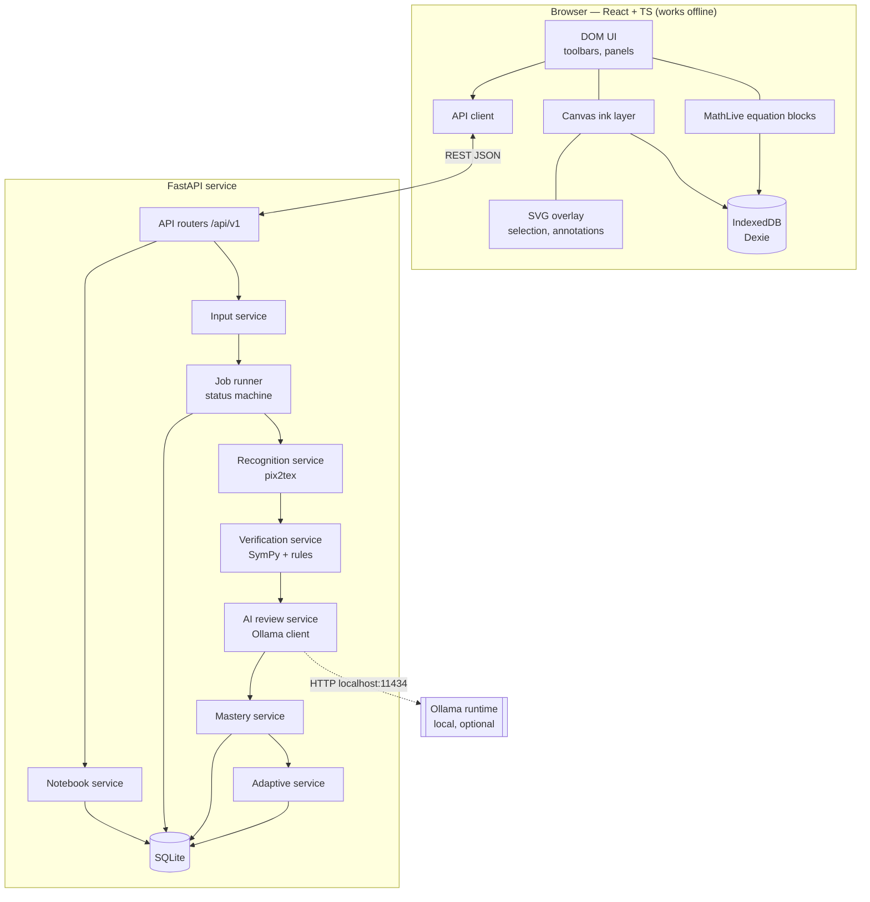
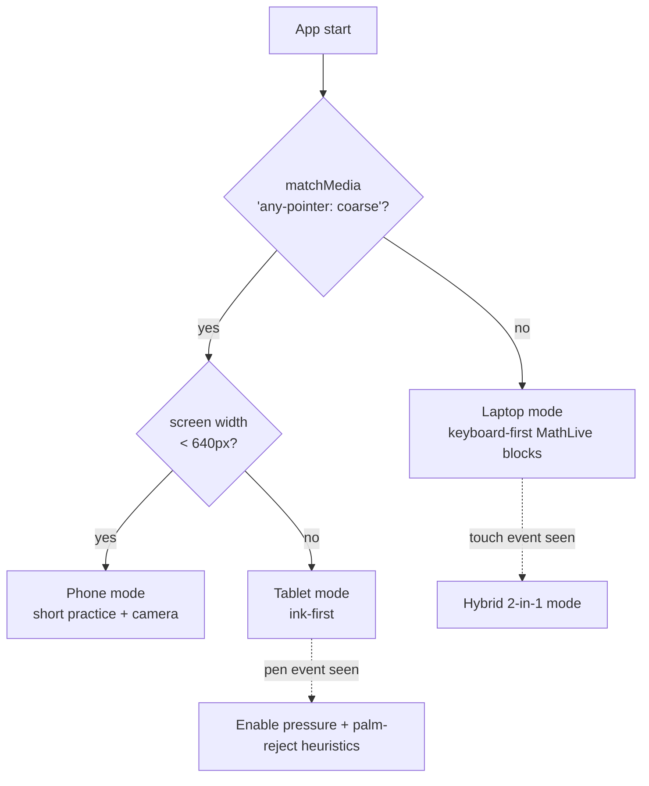
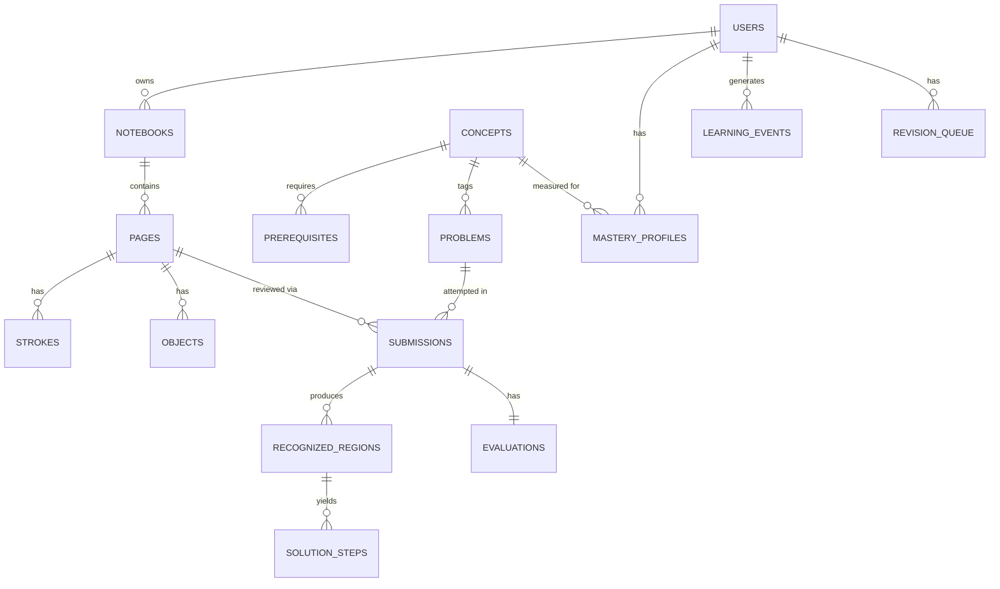
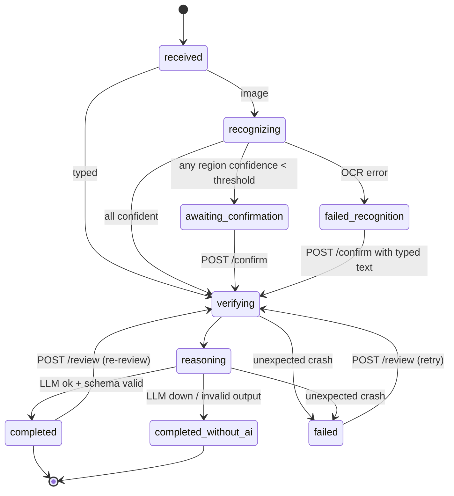
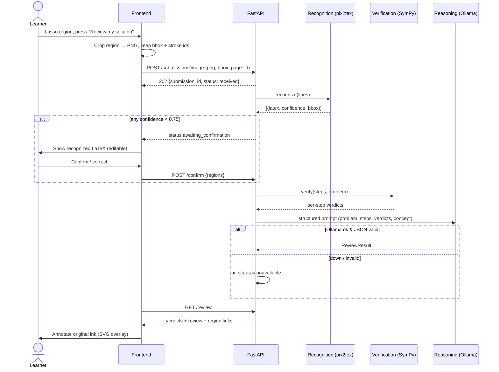

# 02 — Architecture

**Style:** modular monolith. There is **one React app** and **one FastAPI service**, each with well-separated internal modules. This keeps deployment and debugging simple for a hackathon while keeping boundaries clean.

## 1. Logical architecture



**Key property:** the dashed edge to Ollama is **optional**. If it fails, the review still returns verification results with `ai_status = "unavailable"`.

## 2. Frontend modules

| Folder | Responsibility | Owner |
|---|---|---|
| `src/notebook/canvas/` | Pointer Events capture, stroke smoothing, Canvas rendering | M2 |
| `src/notebook/tools/` | Pen, pencil, highlighter, eraser, lasso, shapes; undo/redo command stack | M2 |
| `src/notebook/pages/` | Notebooks → chapters → pages, backgrounds, navigation, bookmarks | M2 |
| `src/notebook/workspace/` | Expandable work areas attached to pages | M2 |
| `src/notebook/annotations/` | SVG overlays anchored to `region_id` bounding boxes | M2 |
| `src/notebook/equations/` | MathLive solution blocks + symbol palette | M2 |
| `src/features/ai-review/` | Review button, status polling, OCR confirm dialog, feedback panel | M2 |
| `src/features/learning/` | Practice flow, next-activity card | M2 / M4 |
| `src/features/analytics/` | Progress/mastery page (Recharts) | M4 |
| `src/services/db/` | Dexie schema + repositories | M2 |
| `src/services/api/` | Typed fetch client generated from OpenAPI | M1 / M2 |
| `src/services/device/` | Capability detection (pointer type, screen class) | M2 |

### Rendering strategy

| Tech | Role |
|---|---|
| Canvas | High-frequency freehand strokes (one canvas per page layer) |
| SVG | Selection outlines, annotations, diagrams |
| DOM/React | Toolbars, menus, panels, accessible controls |
| Pointer Events | Unified pen/touch/mouse; `pointerType` drives defaults |

### Input mode selection



The user can always override the mode in settings.

## 3. Backend modules

```
backend/app/
├── main.py                 # app factory, CORS, routers
├── core/                   # config (pydantic-settings), logging, errors, ownership checks
├── api/v1/                 # notebooks.py, submissions.py, learners.py, health.py
├── models/                 # SQLModel tables
├── schemas/                # Pydantic request/response + ReviewResult
├── repositories/           # DB access per aggregate
└── services/
    ├── recognition/        # pix2tex wrapper, confidence proxy, crop validation
    ├── verification/       # latex→sympy, step checker, rule set, verdicts
    ├── reasoning/          # ollama client, prompt builder, schema validator, fallback
    ├── adaptation/         # mastery update, next-action rules, revision queue
    └── jobs/               # in-process job runner + status state machine
```

## 4. Data model



### Key fields

| Entity | Fields |
|---|---|
| `users` | `id`, `display_name`, `settings_json`, `created_at` |
| `notebooks` | `id`, `owner_id`, `title`, `domain`, `created_at`, `updated_at` |
| `pages` | `id`, `notebook_id`, `chapter`, `order`, `title`, `background` (`ruled`/`squared`/`blank`), `version` |
| `strokes` | `id`, `page_id`, `points[] (x,y normalized 0..1)`, `pressure[]?`, `timestamps[]?`, `tool`, `color`, `width`, `bbox`, `deleted` |
| `objects` | `id`, `page_id`, `kind` (`text`/`equation`/`shape`/`image`/`annotation`), `bbox`, `payload_json` |
| `problems` | `id`, `concept_id`, `prompt_latex`, `expected_answer_latex`, `difficulty (1–5)` |
| `submissions` | `id`, `page_id`, `problem_id?`, `input_mode` (`typed`/`image`/`ink`), `status`, `created_at` |
| `recognized_regions` | `id`, `submission_id`, `bbox`, `source_image_ref`, `latex`, `confidence`, `confirmed`, `corrected_latex?`, `recognizer_version` |
| `solution_steps` | `id`, `submission_id`, `region_id?`, `index`, `latex` |
| `evaluations` | `id`, `submission_id`, `verification_json`, `review_json?`, `ai_status`, `model_version?` |
| `concepts` | `id`, `name`, `domain`, `description` |
| `prerequisites` | `concept_id`, `requires_concept_id` |
| `mastery_profiles` | `user_id`, `concept_id`, `mastery (0..1)`, `attempts`, `updated_at` |
| `learning_events` | `id`, `user_id`, `concept_id`, `kind`, `score`, `hints_used`, `error_type?`, `at` |
| `revision_queue` | `user_id`, `concept_id`, `due_at`, `reason` |

**Rule:** strokes and source images are immutable source artifacts. Recognition, evaluation and annotations are *derived* records linked by `submission_id` and `region_id`.

### Storage split

- **IndexedDB (browser):** notebooks, pages, strokes, objects, cached reviews. This is the offline source of truth for the notebook.
- **SQLite (backend):** submissions, regions, steps, evaluations, concepts, mastery, events.
- **PostgreSQL:** optional later for self-hosted multi-user sync.

## 5. API (v1)

| Method | Endpoint | Purpose |
|---|---|---|
| GET | `/api/v1/health` | Liveness + `{ollama: up/down, pix2tex: loaded/not}` |
| POST | `/api/v1/notebooks` | Create notebook |
| GET | `/api/v1/notebooks` | List notebooks |
| PUT | `/api/v1/notebooks/{id}/pages/{page_id}` | Save page state / metadata |
| POST | `/api/v1/submissions/typed` | Submit typed LaTeX steps |
| POST | `/api/v1/submissions/image` | Upload image/region crop (multipart) |
| POST | `/api/v1/submissions/{id}/confirm` | Confirm/correct recognized expressions |
| POST | `/api/v1/submissions/{id}/review` | Start full review |
| GET | `/api/v1/submissions/{id}/status` | Poll status |
| GET | `/api/v1/submissions/{id}/review` | Get review result |
| GET | `/api/v1/learners/me/mastery` | Mastery profile |
| GET | `/api/v1/learners/me/revision` | Due revision items |
| GET | `/api/v1/learners/me/next` | Next recommended activity |
| GET | `/api/v1/concepts` | Concept graph |
| GET | `/api/v1/problems?concept=…` | Problems for a concept |

Long-running work returns a `submission_id`. The client **polls** `/status` every 1 s with backoff. WebSockets are optional and come later.

### Submission status machine



## 6. Review pipeline (sequence)



## 7. Verification design

- **Parse:** LaTeX → SymPy via `sympy.parsing.latex.parse_latex` (needs `antlr4-python3-runtime==4.11.*`), after normalizing (`\cdot`→`*`, `\left(`→`(`, implicit multiplication, `=` split).
- **Equation step check:** step *k* → *k+1* is `supported` if the solution sets are equal (`solveset` over the declared domain, default ℝ). It is `incorrect` if they differ. It is `inconclusive` if solving fails or times out (2 s limit), or the step involves an unsupported construct.
- **Expression step check:** `simplify(a - b) == 0` with a numeric spot-check fallback at random points.
- **Domain care:** detect division by a symbolic expression, square roots, logs, inequalities and trig. Flag a lost or gained solution as a *domain warning*, not a silent pass.
- **Verdict enum:** `supported | incorrect | inconclusive`. `first_error_step` is the first `incorrect` step.

## 8. AI reviewer contract

Input to the LLM (structured, never a raw page): problem, ordered steps, OCR confidence/corrections, verification verdicts, concept + prerequisites, minimal prior-error history.

Output (validated with Pydantic, `extra="forbid"`):

```json
{
  "status": "incorrect",
  "first_error_step": 2,
  "concept": "linear_equations",
  "error_type": "algebraic_transformation",
  "explanation": "The transformation is not supported by the previous line.",
  "hint": "Check whether the same operation was applied to both sides.",
  "confidence": 0.7,
  "recommended_action": "targeted_practice"
}
```

Rules:
- `status` and `first_error_step` **must agree with SymPy**. If they don't, the backend overrides them with the SymPy values and logs a disagreement.
- Allowed `error_type`: `arithmetic_slip`, `algebraic_transformation`, `sign_error`, `formula_selection`, `domain_violation`, `missing_prerequisite`, `incomplete`, `other`.
- Allowed `recommended_action`: `continue`, `increase_difficulty`, `targeted_practice`, `prerequisite_review`, `worked_example`, `schedule_revision`, `ask_another_question`.
- The backend retries once on invalid JSON (using Ollama `format: "json"`), then falls back to `completed_without_ai`.

## 9. Adaptive engine

- **Mastery update:** `M_new = 0.7 · M_old + 0.3 · S`, with `S ∈ [0,1]` (1 = correct without hints; 0.6 = correct after hints; 0.3 = partially correct; 0 = incorrect). Initial `M = 0.3`. Display it as an *estimate*.
- **Next-action rules:**

| Evidence | Action |
|---|---|
| Last 3 correct, M ≥ 0.8 | `increase_difficulty` / unlock next concept |
| Repeated `missing_prerequisite` / conceptual error (2+ in last 5) | `prerequisite_review` on the weakest prerequisite |
| `arithmetic_slip` inside a larger solution | `targeted_practice` (arithmetic) and stay on topic |
| Correct only after ≥2 hints | `schedule_revision` (due in 1 day) |
| Improved after revision | Return to topic, new problem (transfer test) |
| < 2 attempts or uncertain evidence | `ask_another_question` — no strong claim |

Every recommendation carries a human-readable `reason` string shown to the learner.

## 10. Security & reliability

- Upload limits: PNG/JPEG/WebP only (checked with magic bytes), ≤ 5 MB, ≤ 4096×4096 px.
- Recognition and inference run in worker threads with timeouts (OCR 20 s, LLM 60 s).
- No `eval`/`exec` of any model output. JSON parse only, then schema validation.
- Ownership check on every `notebook_id` / `page_id` / `submission_id`.
- Secrets only in `.env`; `.env.example` is committed.

### Failure handling

| Failure | Behaviour |
|---|---|
| Unreadable handwriting | Ask for clearer crop or typed correction; no verdict |
| LLM unavailable | Keep work; `completed_without_ai`; show deterministic results |
| OCR process fails | Keep image; allow retry or manual typing |
| Unparseable maths | Name the region that failed; no correctness claim |
| Autosave failure | Visible warning banner; keep in-memory state; retry |
| Too-large image | Explain limits; offer crop |
