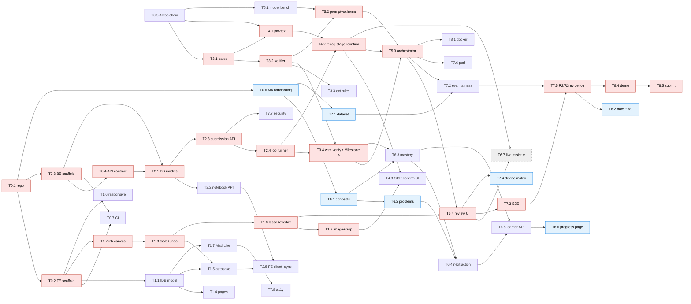
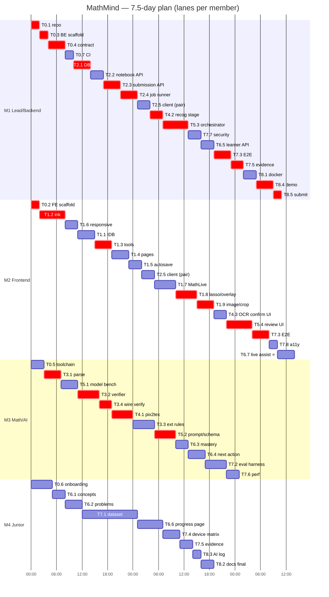

# 04 — Dependencies, Parallelism & Critical Path

This guide is for humans **and AI agents**. It answers three questions: *can I start this task now? what can run at the same time? what must not slip?*

## 1. Dependency graph



Red = critical path · Blue = M4 tasks · Dashed = P1 stretch

## 2. Prerequisite lookup table

| Task | Hard prerequisites (must be `done`) | Soft / mock-ok (can start against mock) |
|---|---|---|
| T0.1 | — | — |
| T0.2 | T0.1 | — |
| T0.3 | T0.1 | — |
| T0.4 | T0.3 | — |
| T0.5 | — | — |
| T0.6 | T0.1 | T0.2/T0.3 for "run locally" step |
| T0.7 | T0.2, T0.3 | — |
| T1.1 | T0.2 | T0.4 (draft types) |
| T1.2 | T0.2 | — |
| T1.3 | T1.2 | — |
| T1.4 | T1.1 | — |
| T1.5 | T1.1, T1.3 | — |
| T1.6 | T0.2 | — |
| T1.7 | T1.1 | T2.3 (use MSW mock for "Check steps") |
| T1.8 | T1.3 | — |
| T1.9 | T1.8 | — |
| T2.1 | T0.3, T0.4 | — |
| T2.2 | T2.1 | — |
| T2.3 | T2.1 | — |
| T2.4 | T2.3 | stub stages for M3 services |
| T2.5 | T2.2, T1.5 | — |
| T3.1 | T0.5 | — |
| T3.2 | T3.1 | — |
| T3.3 | T3.2 | — |
| T3.4 | T3.2, T2.4 | — |
| T4.1 | T0.5, T3.1 | — |
| T4.2 | T2.4, T4.1 | T4.1 can be mocked for endpoint work |
| T4.3 | T1.9 | T4.2 (MSW `awaiting_confirmation` example) |
| T5.1 | T0.5 | early dataset items (T7.1) helpful |
| T5.2 | T3.2, T5.1 | — |
| T5.3 | T3.4, T4.2, T5.2 | T5.2 can be stubbed to unblock the fallback path |
| T5.4 | T1.8 | T5.3 (MSW review examples) |
| T6.1 | T0.6 | — |
| T6.2 | T6.1 | — |
| T6.3 | T6.1, T3.4 | — |
| T6.4 | T6.3, T6.2 | — |
| T6.5 | T6.3, T6.4 | — |
| T6.6 | — | T6.5 (MSW `Mastery.json`, `NextAction.json`) |
| T6.7 | T5.4, T4.2 | — |
| T7.1 | T0.6 | — |
| T7.2 | T5.3, T7.1 (≥ 40 items) | — |
| T7.3 | T5.4 | individual specs can be written as features land |
| T7.4 | T5.4 | partial runs after T1.* |
| T7.5 | T7.2, T7.3 | — |
| T7.6 | T5.3 | — |
| T7.7 | T2.3 | — |
| T7.8 | T1.7 | — |
| T8.1 | T5.3 | — |
| T8.2 | T7.5 | — |
| T8.3 | — (continuous) | — |
| T8.4 | T7.5 | script draft from Day 5 |
| T8.5 | T8.4 | — |

## 3. Parallel lanes

Four people means at most four tasks in progress at once. Each lane is one person's sequence; lanes only touch at the **sync points**.



> The Gantt shows **relative order and effort in hours** (one working day is about 8 h). The calendar start date is a placeholder; use the day-by-day table in `plan/README.md` for actual days.

### What can always run in parallel (no shared files)

| Group | Tasks | Why it's safe |
|---|---|---|
| A | Frontend ink (T1.2–T1.5) ‖ Backend core (T2.1–T2.4) ‖ Math (T3.1–T3.3) ‖ M4 data (T6.1, T6.2, T7.1) | Different folders; the contract (T0.4) is the only shared surface |
| B | T4.1 pix2tex ‖ T1.9 image crop | Agree only on "PNG + bbox" (already in the contract) |
| C | T5.2 prompt/schema ‖ T4.2 confirm endpoint ‖ T4.3 confirm UI | Linked only through the contract |
| D | T6.3/T6.4 engine ‖ T5.4 review UI ‖ T6.6 progress page (mock) | Different modules; MSW mocks |
| E | T7.2 eval ‖ T7.3 E2E ‖ T7.4 manual ‖ T7.6 perf ‖ T7.7 security | Read-only against the built system |

### What must be sequential

| Chain | Reason |
|---|---|
| T0.1 → T0.3 → T0.4 → T2.1 | The contract defines the DB shapes |
| T1.2 → T1.3 → T1.8 → T1.9 | Each builds on the canvas/tool system |
| T3.1 → T3.2 → T3.4 | The verifier needs the parser; wiring needs the verifier |
| T2.3 → T2.4 → T3.4 / T4.2 → T5.3 | The pipeline needs the runner, which needs submissions |
| T7.2 + T7.3 → T7.5 → T8.4 → T8.5 | Evidence needs working tests; the demo needs evidence |

## 4. Critical path

```
T0.1 → T0.3 → T0.4 → T2.1 → T2.3 → T2.4 → T3.4 → T5.3 → T5.4 → T7.3 → T7.5 → T8.4 → T8.5
                                        ↑            ↑      ↑
                          T3.1 → T3.2 ──┘   T5.1 → T5.2┘   T1.2 → T1.3 → T1.8
                                         T4.1 → T4.2 ─┘
```

**Slack:** ≈ 0.5 day overall. If any red task slips by more than half a day, M1 triggers the scope-cut ladder (`plan/README.md`).

## 5. Sync points

| When | Sync | Participants | Exit criteria |
|---|---|---|---|
| Day 1 noon | **Contract freeze v0** (T0.4) | M1, M2, M3 | Schemas merged; mocks run |
| Day 3 EOD | **Milestone A** | all | Typed steps → SymPy verdicts in UI |
| Day 4 noon | **OCR contract check** | M1, M2, M3 | Image → regions → confirm works with the real pix2tex |
| Day 5 EOD | **Milestone B** | all | Full review incl. AI + annotation + mastery; scope cuts decided |
| Day 6 PM | **Feature freeze + dry run #1** | all | Only bug fixes after this |
| Day 7 noon | **Release tag `v0.1.0`** | M1 | Evidence complete; video recorded |

## 6. Mocking strategy

These mocks let people work in parallel without waiting for each other.

| Consumer | Needs | Mock | Provided by | Available |
|---|---|---|---|---|
| M2 (T1.7, T4.3, T5.4) | Submission/review API | MSW handlers serving `shared/contracts/examples/*.json`; toggle `VITE_USE_MOCKS=true` | M1 (T0.4) | Day 1 noon |
| M4 (T6.6) | Mastery / next-action API | Same MSW, `Mastery.json`, `NextAction.json` | M1 (T0.4) | Day 1 noon |
| M1 (T2.4, T4.2) | Verify / recognize / reason services | Stub stage functions returning fixture results | M1 (T2.4) | Day 3 |
| M1 (T5.3 fallback path) | Ollama down/up | `respx`/`httpx.MockTransport` in tests; run with `OLLAMA_URL=http://localhost:1` for "down" | M1 | Day 4 |
| M3 (T5.2 tests) | LLM output | Fixture JSON strings (valid, malformed, hostile) | M3 | Day 4 |
| M3 (T4.1 tests) | pix2tex | Monkeypatch `LatexOCR.__call__` | M3 | Day 3 |

**Mock rule:** a mock may only return shapes that exist in the contract. If you need a new field, change the contract first (M1 approves).

## 7. Rules for AI agents choosing work

1. Read `docs/task-board.md`. Filter to *your member's* rows with status `todo`.
2. For each one, look up §2 above. If all hard prerequisites are `done` → eligible. If only soft ones are missing → eligible **with mocks**.
3. Pick the eligible task with the **lowest ID on the critical path** first, otherwise the lowest ID.
4. Set the status to `in-progress` with your branch name **before** starting.
5. If nothing is eligible, do the member's **"while blocked"** list (in their guide). Don't start someone else's task.
6. When finished: status `review`, PR link. After merge, the owner sets `done`.
