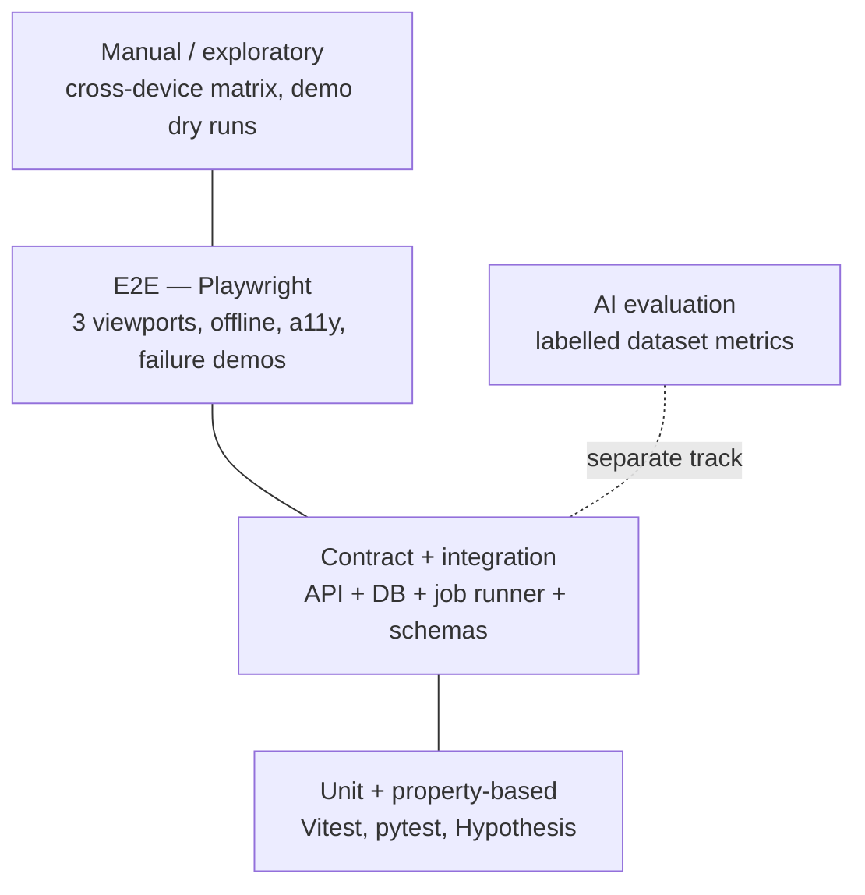

# 05 — Testing Strategy

**Principle:** test where the risk is. For MathMind the biggest risks are **false "incorrect" verdicts**, **lost notebook work** and **silent AI failures**. Most test effort goes to those three.

## 1. Test pyramid

## 2. Test types: what, tool, owner, when

| # | Type | What it checks | Tool | Owner | When it's written | When it runs |
|---|---|---|---|---|---|---|
| 1 | **Unit (frontend)** | Pure functions: geometry, smoothing, history stack, debounce, mode detection | Vitest | M2 (M4 for analytics) | With each T1.x task | Every commit (CI) |
| 2 | **Component** | React components render and behave (toolbar, confirm panel, review panel) | Vitest + Testing Library + MSW | M2, M4 | With each UI task | CI |
| 3 | **Unit (backend)** | Repos, state machine, upload validation | pytest | M1 | With T2.x | CI |
| 4 | **Unit (math)** | Parser, verifier rules, mastery formula, next-action rules | pytest (table-driven) | M3 | With T3.x / T6.x | CI |
| 5 | **Property-based** | Parser round-trip; correct chains always `supported`; mutation → `incorrect` at the right step; mastery ∈ [0,1] | Hypothesis | M3 | T3.1, T3.2, T6.3 | CI |
| 6 | **Contract** | Examples validate against JSON Schema; API responses match OpenAPI; TS types compile | `jsonschema`, schemathesis, `tsc` | M1 | T0.4 onwards | CI on any contract change |
| 7 | **Integration (API)** | Endpoint + DB + job runner with stubbed ML | pytest + TestClient | M1 | T2.2–T2.4, T4.2, T5.3, T6.5 | CI |
| 8 | **ML integration** | Real pix2tex on fixture images | pytest `-m ml` | M3 | T4.1 | Locally + nightly (heavy) |
| 9 | **LLM integration** | Real Ollama model returns schema-valid output | pytest `-m llm` | M3 | T5.2 | Locally only |
| 10 | **LLM robustness / fuzz** | Malformed, hostile or oversized model output is rejected or sanitized | pytest fixtures | M3 | T5.2 | CI |
| 11 | **Failure injection** | IDB write failure, OCR crash, OCR timeout, Ollama down/timeout, invalid JSON | Vitest mocks, pytest monkeypatch, dead `OLLAMA_URL` | M1, M2, M3 | T1.5, T2.4, T4.2, T5.3 | CI + E2E |
| 12 | **E2E** | Full user flows in a real browser | Playwright | M1 + M2 | T7.3 (specs added as features land) | Nightly + before merge to release |
| 13 | **Offline** | Notebook works with no network | Playwright `setOffline` | M2 | T2.5 / T7.3 | Nightly |
| 14 | **Cross-device (emulated)** | Layout and input modes on phone/tablet/laptop viewports | Playwright projects | M2 | T1.6 / T7.3 | Nightly |
| 15 | **Cross-device (real)** | Stylus feel, palm rejection, camera, virtual keyboard | Manual checklist | **M4** | T7.4 | Day 6 + re-test Day 7 |
| 16 | **Visual regression** | Unintended UI changes | Playwright `toHaveScreenshot` | M2 | Day 5+ | Nightly |
| 17 | **Accessibility** | axe rules, keyboard-only flow, screen reader basics, contrast | `@axe-core/playwright`, NVDA/VoiceOver | M2 (+M4) | T7.8 | Nightly + manual Day 6 |
| 18 | **Performance** | Ink frame time, page load with 500 strokes, stage latency p50/p95, RAM | Chrome DevTools, `psutil`, timing script | M3 (+M2 for FE) | T7.6 | Day 6 |
| 19 | **Load (light)** | 5 concurrent submissions → no errors | `httpx` async script | M3 | T7.6 | Day 6 |
| 20 | **Security** | Upload abuse, ownership, dependency CVEs, no eval of model output, secrets | bandit, pip-audit, npm audit, schemathesis, gitleaks | M1 | T2.3, T7.7 | CI (audit) + Day 4 |
| 21 | **Privacy** | No outbound network except localhost; export/delete works | DevTools Network, manual | M1 + M4 | T7.7 | Day 6 |
| 22 | **AI evaluation** | Recognition accuracy, first-error localization, error classification, explanation validity, hint usefulness, latency | `ai/evaluation/run_eval.py` + human ratings | M3 (+M4 data/ratings) | T7.1, T7.2 | Day 5–6, and after any prompt/model change |
| 23 | **Regression** | Every fixed bug gets a test | the relevant tool | whoever fixes it | On bug fix | CI |
| 24 | **Smoke** | App boots, health OK, one typed review works | `scripts/smoke.sh` + Playwright smoke | M1 | T0.7 | Daily 18:00 integration check + before demo |
| 25 | **UAT / demo dry run** | The story works end-to-end on the demo hardware | Manual, timed | all | T8.4 | Day 6 PM, Day 7 AM |

## 3. Testing timeline

| Day | Testing focus |
|---|---|
| 0 | CI skeleton, smoke tests, toolchain smoke (T0.5) |
| 1 | Contract tests (T0.4); unit tests for ink geometry, parser |
| 2 | Property-based tests for the parser/verifier; repo integration tests; M4 starts the dataset |
| 3 | Integration: typed pipeline end-to-end (**Milestone A**); first Playwright spec (typed review, keyboard-only) |
| 4 | Upload security tests; OCR integration (`-m ml`); LLM robustness fuzz; failure injection for Ollama down |
| 5 | E2E for the image + review flow; first eval harness run (≥ 40 items); **Milestone B** |
| 6 | Full E2E across 3 viewports; offline; a11y; perf; real-device matrix (M4); eval on ≥ 100 items; R2/R3 evidence; dry run #1 |
| 7 | Re-test fixed bugs; final smoke on the demo machine; dry run #2 |

## 4. Quality gates

| Gate | Requirement |
|---|---|
| Every PR | lint + typecheck + unit + component + contract + integration (non-ML) pass |
| Merge to `main` | 1 approval; task-board row updated; disclosure row added if AI-assisted |
| Milestone A | typed E2E passes; verifier unit + property tests pass |
| Milestone B | image E2E passes with mocked OCR; Ollama-down E2E passes |
| Release `v0.1.0` | all E2E pass on 3 viewports; axe has no serious/critical issues; eval report committed; device matrix passes for the claimed devices; **0 false "incorrect" verdicts caused by OCR in the eval set** |

## 5. Test data & fixtures

| Fixture | Location | Owner |
|---|---|---|
| Contract examples | `shared/contracts/examples/` | M1 |
| LaTeX parse cases | `backend/tests/verification/cases.yaml` | M3 |
| Handwriting images | `datasets/handwriting_samples/` | M4 |
| Labelled solutions | `datasets/labelled_solutions/` | M4 |
| LLM output fixtures (valid/malformed/hostile) | `backend/tests/reasoning/fixtures/` | M3 |
| Seed demo notebook | `scripts/seed_demo.py` | M1 |

## 6. Conventions

- Backend markers: `unit`, `integration`, `ml`, `llm`, `slow`. CI runs `-m "not ml and not llm"`.
- Test names describe behaviour: `test_division_by_variable_flags_lost_root`.
- Frontend tests live next to the code: `Foo.test.tsx`. E2E lives in `frontend/e2e/`.
- No test may call the internet. Ollama and pix2tex are localhost only and mocked in CI.
- A flaky test gets fixed or quarantined (`test.fixme`) the same day, with an issue.
